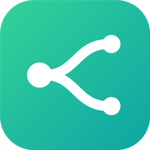
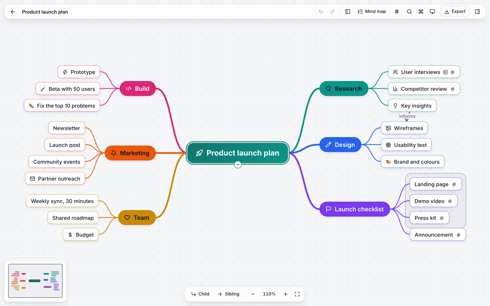
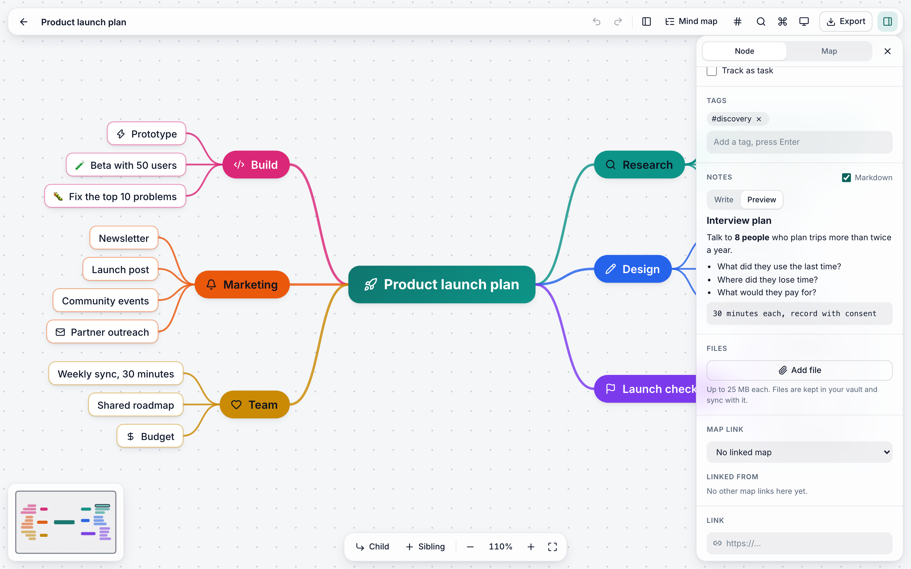
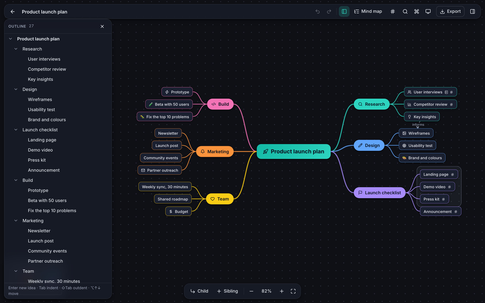
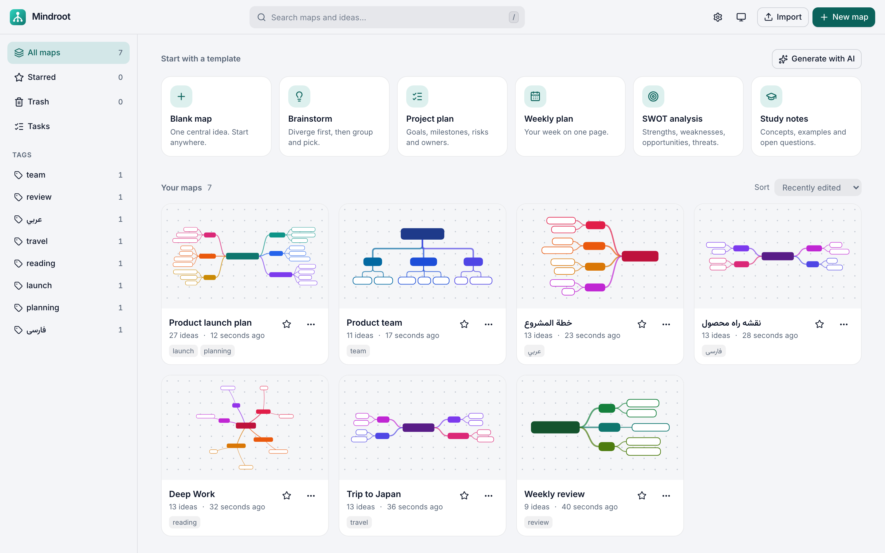
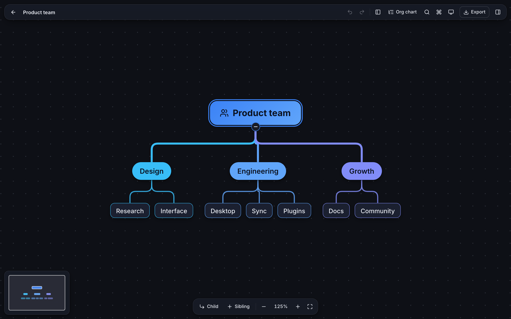
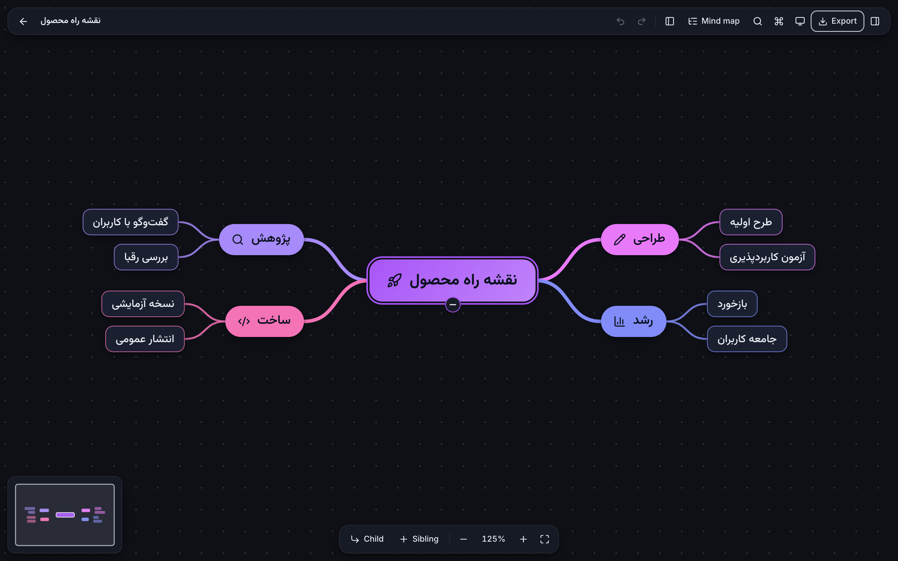
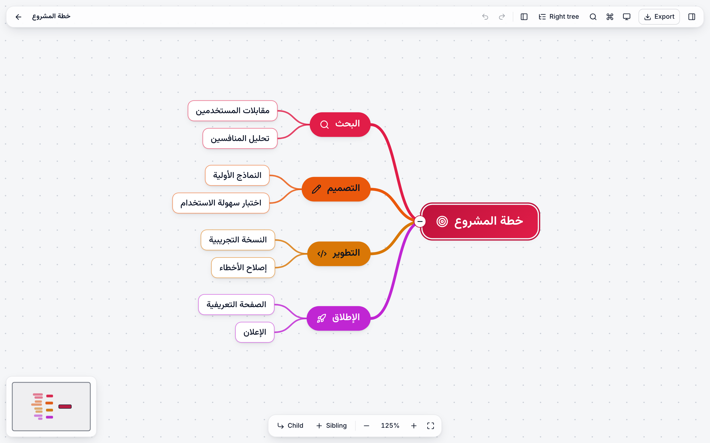

<div align="center">



# Mindroot

**A fast, keyboard-first mind-mapping app for the desktop and the browser.**<br />
Local-first. Your maps are plain files on your disk. Sync them with your own Git repository.

[](https://github.com/falhad/mindroot/actions/workflows/ci.yml)
[](https://github.com/falhad/mindroot/releases/latest)
[](LICENSE)
[](CONTRIBUTING.md)

[Try it in the browser](https://mindroot.app) · [Download](#download) · [Features](#features) · [Build from source](#build-from-source) · [Write a plugin](docs/plugins.md) · [Contribute](CONTRIBUTING.md)

<picture>
  <source media="(prefers-color-scheme: dark)" srcset="docs/screenshots/map-dark.png" />
  
</picture>

</div>

## Why Mindroot

- **Your data stays yours.** No account and no cloud. Each map is one readable JSON Lines file. The app works fully offline.
- **Made for the keyboard.** `Tab` adds a child, `Enter` adds a sibling, the arrow keys move. You can build a full map and never touch the mouse.
- **Git is the sync engine.** Point the app at a private Git repository. Two computers can edit the same map; Mindroot merges them idea by idea, not line by line.
- **Right-to-left is a first-class citizen.** Persian, Arabic and Hebrew maps mirror the whole layout. The Vazirmatn font is bundled and embedded in exports.
- **Open to extension.** Git sync, the AI assistant and live collaboration are plugins on the same public API that you can use.

Built with Tauri 2 (Rust), React 19, TypeScript, Vite, Tailwind 4 and Zustand. The installer is small and the app starts fast, because Tauri uses the system web view and not a bundled browser.

## Download

Get the installer for your system from the [latest release](https://github.com/falhad/mindroot/releases/latest).

| System | File |
|---|---|
| macOS (Apple Silicon) | `Mindroot_<version>_aarch64.dmg` |
| macOS (Intel) | `Mindroot_<version>_x64.dmg` |
| Windows | `Mindroot_<version>_x64-setup.exe` or `.msi` |
| Linux | `.AppImage`, `.deb` or `.rpm` |

The builds are not code-signed yet. Your system shows a warning the first time:

- **macOS:** move the app to Applications, then run `xattr -dr com.apple.quarantine /Applications/Mindroot.app`. Or right-click the app, choose **Open**, and confirm.
- **Windows:** on the SmartScreen dialog choose **More info → Run anyway**.
- **Linux:** `chmod +x Mindroot_*.AppImage` and run it, or install the `.deb` / `.rpm`.

### Web version

Use Mindroot without an install at **[mindroot.app](https://mindroot.app)**. Your maps stay in your browser and are not sent to a server. The site counts visits with Cloudflare Web Analytics, which sets no cookies. Git sync and quick capture need the desktop app: the **Download** button in the web version offers the installer for your system and shows the install steps. To host it yourself, see [docs/web.md](docs/web.md). A plain-text description for AI assistants is at [mindroot.app/llms.txt](https://mindroot.app/llms.txt).

## Features

### Think on an infinite canvas

Six layouts (mind map, right tree, left tree, org chart down and up, radial), three line styles, six colour themes, light and dark. Each idea can have a colour, shape, icon, tags, a due date, a checklist, attached files and a link to another map. Cross-links, groups, summary brackets, floating ideas and sticky notes add structure.

### Notes in Markdown, with code and LaTeX



### Outline, focus and presentation

Edit the map as a list beside the canvas (`⌘⇧O`). Work on one branch alone in focus mode (`⌘.`). Present one idea or one branch at a time (`F5` / `⇧F5`).



### A library for all your maps

Search across titles and idea text. Star, tag, sort, trash and restore. Start from six templates or save your own. A tasks view shows the open tasks of all maps.

<picture>
  <source media="(prefers-color-scheme: dark)" srcset="docs/screenshots/dashboard-dark.png" />
  
</picture>

### Six layouts



### Right-to-left maps

Persian, Arabic and Hebrew maps mirror the whole layout.





### Sync, teamwork and AI

| | |
|---|---|
| **Git sync** | Keep maps in a private Git repository and in step across computers, with idea-by-idea merging. Restore an old version of a map, or one idea from it. [docs/sync.md](docs/sync.md) |
| **Live collaboration** | Edit one map together in real time through a small relay server that you run. Presence, and undo that only undoes your own edits. [docs/collab.md](docs/collab.md) |
| **AI assistant** | Make a whole map from a topic or a pasted text. Expand an idea, find gaps, summarize, rewrite. Use your own key with any OpenAI-compatible or Anthropic-compatible service. [docs/ai.md](docs/ai.md) |
| **Plugins** | Add commands, header chips, settings panels and event listeners. Install from the plugin gallery. [docs/plugins.md](docs/plugins.md) |
| **Compare** | See the difference between two maps or two versions. |
| **Quick capture** | A system-wide shortcut (default `Alt+Shift+Space`) puts a thought into your Inbox map. |

### Import and export

- **Import:** Markdown and indented outlines, FreeMind (`.mm`), OPML, XMind, Obsidian canvas, Mindroot JSON, and any `{text|title, children}` JSON.
- **Export:** JSON, Markdown, OPML, PNG, SVG, PDF (vector with selectable text, or image), and a single-file web page that opens anywhere.

The full feature guide is in [docs/features.md](docs/features.md).

## Keyboard

| Action | Key |
|---|---|
| Add child / sibling / sibling above | `Tab` / `Enter` / `Shift Enter` |
| Edit text | `F2` or double-click |
| While typing: new sibling / new child / newline / finish | `Enter` / `Tab` / `Shift Enter` / `Esc` |
| Delete / duplicate | `Del` / `⌘D` |
| Collapse or expand | `Space` |
| Focus on a branch / leave focus | `⌘.` / `Esc` |
| Outline panel | `⌘⇧O` |
| Present (by idea / by branch) | `F5` / `⇧F5` |
| New floating idea / sticky note | double-click / `⇧`+double-click on empty canvas |
| Move selection | arrow keys (`Shift` extends) |
| Reorder / indent / outdent | `⌥↑↓` / `⌥→` / `⌥←` |
| Undo / redo | `⌘Z` / `⌘⇧Z` |
| Select all | `⌘A` |
| Copy / cut / paste | `⌘C` `⌘X` `⌘V` |
| Fit / 100% / zoom | `⌘0` / `⌘1` / `⌘+` `⌘-` |
| Palette / find / export / panel | `⌘K` / `⌘F` / `⌘E` / `⌘I` |

(`Ctrl` on Windows and Linux. Press `?` in the app for the full sheet, or press `⌘K` and type `help`. The first map you open shows a short tour of the basics.)

## Build from source

Requirements: Node 20+, pnpm, Rust 1.80+, Git (for sync), and the [Tauri system dependencies](https://tauri.app/start/prerequisites/).

```bash
pnpm install
pnpm tauri dev        # desktop app (hot reload)
pnpm dev              # browser only: http://localhost:1420 (maps live in IndexedDB)
pnpm tauri build      # installer for this computer (.app/.dmg, .msi, .deb ...)
                      # all platforms: push a tag, see docs/releasing.md
```

Tests:

```bash
pnpm typecheck
pnpm test             # unit + sync tests (vitest; the sync tests use real git)
pnpm e2e              # end-to-end tests in a browser (Playwright)
cargo test --manifest-path src-tauri/Cargo.toml   # storage, git runner, and an IPC test of every command
```

`node scripts/readme-shots.mjs` makes the screenshots on this page again. `scripts/deploy-web.sh` puts the web version on a server ([docs/web.md](docs/web.md)).

## Architecture

```
src/core     Pure TypeScript, no React, fully unit-tested (also: focus, present, diff, links, tasks, tags, import/ and export/)
  tree.ts      document model + every edit (works on Immer drafts)
  layout.ts    6 layout algorithms, spatial navigation, hit-testing
  measure.ts   canvas text measurement + wrapping (shared by DOM and SVG)
  visual.ts    how a node looks (colours, shapes) - shared by DOM and SVG
  svg.ts       SVG renderer for export and dashboard thumbnails
  outline.ts   Markdown/JSON import, Markdown export, document sanitising
src/state    Zustand stores: doc (history, selection, derived layout), view, ui, library, search
src/io       storage (Tauri commands or IndexedDB), image assets, exporters, file dialogs
src/sync     Git sync engine + three-way map merge (pure, tested against real Git)
src/plugins  plugin API, host, loader for installed plugins; builtin/ has Git sync, AI and collaboration
src/ui       React components
src-tauri    Rust: atomic file storage, Git runner, network and secrets commands, plugin install
server/relay The small relay server for live collaboration (Node, Docker)
```

Design notes:

- **One map, one file, one record per line.** Each map is `<app-data>/vault/maps/<id>.jsonl` (JSON Lines), written atomically (temp file + rename). The first line holds a `meta` block, so the dashboard lists maps by reading one line each. Images are content-addressed files in `vault/assets/`. Thumbnails and search text live in a local cache. `sanitizeDoc` repairs dangling ids, cycles and bad enums on load. Format details: [docs/sync.md](docs/sync.md).
- **Merge by idea, not by line.** One record per line lets Git see small diffs. On a conflict, a three-way merge works on ideas: two people can edit different ideas of one map and both edits survive.
- **Undo = array of Immer snapshots.** Structural sharing keeps this cheap. Rapid edits with the same key (typing in notes) merge into one step.
- **Same numbers everywhere.** Node sizes come from one measure function; the canvas, minimap, thumbnails and all exports read the same layout, so exports match the screen.
- **Browser version.** Outside Tauri the storage layer uses IndexedDB. So `pnpm dev` is a complete app for fast UI work, and `pnpm build` gives the static web version.
- PDF export has two forms: vector (shapes and selectable text, Helvetica) for maps whose text a PDF base font can draw, and a 2-3x raster on a page sized to the map for the rest (Persian, Arabic, CJK, emoji). See [docs/features.md](docs/features.md).

## Roadmap

Not built yet. Help is welcome on each item:

- A mobile app.
- Public share links (the web-page export is the closest today).
- Per-room revocable collaboration tokens (today, a change of the relay secret revokes all).
- Vector PDF text for scripts that a PDF base font cannot shape (Persian and Arabic use the image PDF today).
- Code-signed installers for macOS and Windows.

## Contributing

Bug reports, ideas, plugins and pull requests are welcome. Start with [CONTRIBUTING.md](CONTRIBUTING.md). For a security problem, see [SECURITY.md](SECURITY.md).

If Mindroot is useful to you, a star helps other people find it.

## Releases

GitHub Actions run the tests on every push (`ci.yml`) and build installers for macOS, Windows and Linux when a version tag is pushed (`release.yml`). See [docs/releasing.md](docs/releasing.md).

## License

[MIT](LICENSE)
